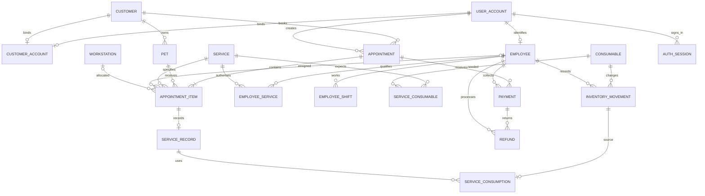

# PawCare 数据库设计与范式论证

## 1. Problem and Requirements

一家宠物洗护门店需要将顾客、宠物、预约、员工、工位、护理记录、耗材和收退款联系起来。目标是避免重复排班、错用宠物档案、库存负数以及财务记录不一致，并让四种角色完成连续的业务流程。

角色：顾客只能管理自己的资料与预约；前台管理到店与收款；护理师处理分配给自己的任务；店长管理资源、退款、报表和登录账号。无账号的线下顾客同样可建立档案。

2026-10-15 更新：版本 4 统一界面、既有演示文本及默认数据为英文。用户管理复用 user_account、employee、customer_account、customer 与 auth_session，不增加业务表或函数依赖，因此原有 3NF/BCNF 论证不变。历史文本翻译只更新已知映射，不更改主外键、价格、时间或状态；今后用户输入不限语言。详见 [本轮报告](english-and-accounts-2026-10-15.md)。

重要假设：单店；支持猫狗；一只宠物只有一位登记主人；同一预约只能属于一个顾客，但可包含多只宠物、多项服务；每个服务项使用一位已授权员工和一个对应类型的工位；洗护与修剪拆为连续服务项。账户不同时绑定员工和顾客。金额为 AUD，时间戳带时区，显示使用悉尼时间。

请求尚未确认时，资源、实际安排时间与报价均为空。确认后保存约定价格，不随价目表变化。取消/未到店不收费；已开始服务不能取消。预约总体状态、应收余额和库存余额均由明细推导。

## 2. Conceptual Design (ER Model)

### 概念关系与参与约束

| 关系 | 基数与参与规则 |
|---|---|
| Customer owns Pet | Customer 0..N，Pet 恰好 1；Pet 全参与 |
| Customer places Appointment | Customer 0..N，Appointment 恰好 1；Appointment 全参与 |
| Account creates Appointment | Account 0..N，Appointment 恰好 1 |
| Customer binds Account | 两端 0..1，以 CustomerAccount 关系表示；绑定行两端均必须存在 |
| Employee uses Account | Employee 恰好 1，Account 0..1；员工全参与 |
| Employee qualified for Service | M:N；EmployeeService 保存资质状态与授权时间 |
| Employee has Shift | Employee 0..N，Shift 恰好 1 |
| Appointment contains Item | 每次应用创建的 Appointment 1..N，Item 恰好 1 |
| Item for Pet / Service | 每个 Item 各恰好 1 个 Pet 和 Service；两者可出现在多个 Item |
| Item assigned Employee / Workstation | requested 时 0；scheduled/in_progress/completed 时各恰好 1 |
| Item has ServiceRecord | Item 0..1；in_progress/completed 时恰好 1；Record 恰好对应 1 个 Item |
| Service expects Consumable | M:N；ServiceConsumable 为每项服务保存标准用量 |
| Consumable has Movement | Consumable 0..N，Movement 恰好 1 |
| Movement sourced by ServiceRecord | use 流水恰好关联一个 Record，其他类型不关联；Record 0..N |
| Appointment receives Payment | Appointment 0..N，Payment 恰好 1 |
| Payment has Refund | Payment 0..N，Refund 恰好 1 |
| Employee records financial/inventory entries | 每条流水必须有经办员工，员工可以经办多条 |

基数中依赖业务状态的参与约束由事务和触发器共同执行，而不是用一个宽泛的可空外键掩盖规则。空预约头不由 API 产生：头与至少一个明细在同一事务创建。

下面是工程用关系概览。它使用 Crow's Foot 记号，不能冒称课程指定的 Chen 记号；正式课程 ER 图可以依据上面的基数/参与约束和下方属性目录转换为讲义规定的矩形、菱形、椭圆与参与线。

## 3. Logical Design and Normalisation

### 全部关系与候选键

`PK` 为选定主键；`AK` 为非空唯一的其他候选键。箭头右边表示该关系其余全部属性。具体列类型、外键与约束见 SQL，以及从实际数据库导出的 `schema-inventory.json`。

| 关系 | PK | 其他候选键 AK | 主要非键属性 |
|---|---|---|---|
| user_account | account_id | email | password_hash, is_active, created_at |
| customer | customer_id | 无 | display_name, phone, created_at, is_active |
| customer_account | customer_id | account_id | 无；两个候选键相互决定 |
| pet | pet_id | 无 | customer_id, pet_name, species, breed, birth_date, sex, latest_weight_kg, care_notes, is_active |
| employee | employee_id | account_id；employee_code | display_name, staff_role, is_active |
| service | service_id | service_code | service_name, species, workstation_type, base_price, default_duration_minutes, is_active |
| employee_service | (employee_id, service_id) | 无 | is_active, authorised_at |
| employee_shift | shift_id | (employee_id, starts_at)；(employee_id, ends_at) | starts_at, ends_at, employee_id |
| workstation | workstation_id | station_code | station_name, workstation_type, is_active |
| appointment | appointment_id | booking_code | customer_id, created_by_account_id, requested_start_at, customer_note, created_at |
| appointment_item | appointment_item_id | (appointment_id, item_no) | pet_id, service_id, employee_id, workstation_id, planned_start_at, planned_end_at, agreed_price, state |
| service_record | appointment_item_id | 无 | actual_start_at, actual_end_at, weight_at_visit_kg, care_notes, result_notes |
| consumable | consumable_id | sku | consumable_name, base_unit, reorder_level, is_active |
| service_consumable | (service_id, consumable_id) | 无 | expected_quantity |
| inventory_movement | movement_id | request_key | consumable_id, movement_kind, quantity_delta, recorded_by_employee_id, reason, recorded_at |
| service_consumption | movement_id | 无 | service_record_id |
| payment | payment_id | receipt_code；request_key | appointment_id, amount, method, received_by_employee_id, received_at |
| refund | refund_id | refund_code；request_key | payment_id, amount, reason, processed_by_employee_id, refunded_at |
| auth_session（技术表） | token_hash | 无 | account_id, expires_at, created_at |
| schema_version（技术表） | version | 无 | installed_at |

### 函数依赖与 BCNF

对每个单键实体，PK → 所有其他属性；每个 AK 也 → 所有其他属性。`employee_service` 中 `(employee_id,service_id) → is_active,authorised_at`，两个单独属性都不能决定资质事实。`service_consumable` 中 `(service_id,consumable_id) → expected_quantity`，单独的服务或耗材都不能决定用量。`customer_account` 中 `customer_id → account_id` 且 `account_id → customer_id`；两者都是候选键。

在上述业务假设的函数依赖集合下，各关系中每个非平凡函数依赖的决定因素都是超键，因此满足 BCNF，也满足 3NF。这里不是仅以“有自增主键”作证明：复合键关系、备用候选键以及容易产生传递依赖的字段都已单独检查。

未假设姓名、电话、品种名、服务显示名或员工显示名唯一。同一电话可能对应家庭成员；服务显示名可重复，稳定身份由服务编码表示。`breed → species` 也不被假定成立：breed 是自由填写的品种描述，不是全局品种分类表。若以后引入规范品种字典，应增加独立分类表并重新分析依赖。

SQL 中 requested 状态的 nullable 分配字段表示“尚未发生安排”，不是候选键。不能从“当前样本中值恰好相同”推断函数依赖。BCNF 分析针对合法非空事实；NULL 与状态条件约束另行验证。

### 避免冗余的关键设计

1. `pet_id → customer_id` 位于 pet。appointment_item 不重复存 customer_id，而通过 appointment 与 pet 校验归属，避免明细上的传递依赖。
2. `payment_id → appointment_id` 位于 payment。refund 只引用 payment_id，不重复存 appointment_id。
3. 员工、服务、工位名称都保留在原实体中，预约明细不复制名称。
4. 当前服务价 `service_id → base_price` 与历史约定价 `appointment_item_id → agreed_price` 是不同事实。不存在 `service_id → agreed_price`，所以价格快照不是违规冗余。
5. 同理，默认时长不决定历史安排时长；planned_end_at 可由工作人员根据该次宠物情况调整。没有额外保存 duration 字段。
6. 库存由不可变流水求和；应收、已付、已退、待收、待退由分别聚合的视图计算，不把派生总额塞入预约头。
7. 服务领用来源单独放在 service_consumption，避免在库存流水上混放可空服务来源和其条件决定的 use 类型。
8. 宠物年龄不存储，由 birth_date 推导。latest_weight_kg 表示当前登记值，weight_at_visit_kg 表示历史到店测量，两者是不同时间语义的事实。

### 分解示例

若在明细保存 `Item(item_id,pet_id,customer_id,pet_name,service_id,service_name,agreed_price,...)`，存在 `pet_id → customer_id,pet_name` 和 `service_id → service_name`，而 pet_id/service_id 不是明细超键。将其分解为 Pet、Service 和 AppointmentItem：交集 pet_id 是 Pet 的键，交集 service_id 是 Service 的键，所以这些二元分解满足无损连接条件；相应依赖保留在实体表内。宠物与预约客户一致是跨关系约束，由事务/触发器校验。

## 4. SQL, Integrity and Transactions

主键、非空唯一候选键、外键、金额/数量/枚举值域构成基础完整性。员工与服务的复合外键保证分配存在授权关系，触发器进一步检查该授权当前有效、物种和工位适配、班次覆盖以及状态转换。

可执行护理的员工角色为护理师和店长，前台不参与护理分配。`05_care_roles.sql` 在数据库层保护资质授予、活动任务分配和员工角色变更；有待开始或进行中任务时，不能停用员工或移除护理角色。没有活动任务时可以更换角色，已有资质与历史护理记录保留，但可用资源查询和最终确认都重新检查角色。该增量迁移仅新增触发器与结构版本，不改变业务表字段、候选键或函数依赖，原有 3NF/BCNF 论证仍适用。

员工、工位和宠物的三个 `EXCLUDE USING gist` 约束保证活动服务的 `[start,end)` 区间不重叠。紧邻服务可在前一项结束的同一时刻开始。员工班次也禁止重叠。

服务完成时，实际领用、来源关联、护理记录结束、服务完成状态和当前体重在同一事务执行。触发器保证库存不为负，记录与状态在提交点一致，并防止历史流水和已结束记录被修改。

事务与并发详见 `transactions-and-demo.md`。SQL 功能使用 JOIN、GROUP BY、HAVING、条件聚合、EXISTS / NOT EXISTS、CTE、UNION ALL、视图、完整性约束和事务。PostgreSQL 特有的排除约束是实现强化；讲解仍应以课程学过的键、依赖、约束、隔离和回滚概念为基础，不把额外语法等同于更高成绩。
